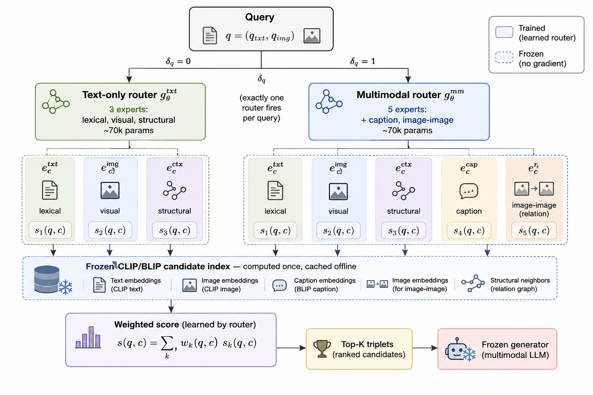

# MuRoK: Multi-level Routing for Knowledge Graph Retrieval

[](TODO_LINK)
[](https://www.python.org/downloads/)
[](https://pytorch.org/)
[](LICENSE)

Official implementation of **"MuRoK: Multi-level Routing for Knowledge Graph Retrieval"**, accepted at the **NeurIPS 2026 Workshop on Personalized, Aligned, Long-Term Memory for AI Systems**.

**Haji Gul**, **Ajaz Ahmad Bhat** — School of Digital Science, Universiti Brunei Darussalam

---

## TL;DR

Multimodal knowledge graph retrievers apply one fixed aggregation rule to every candidate. MuRoK instead learns **where to look, per candidate and per query**, using two levels of routing over *frozen* CLIP/BLIP encoders. With **fewer than 150K trainable parameters** and no representation learning, it is **best on all 25 reported metrics** on FB15k-237-IMG.

---

## Overview


<p align="center">
  
</p>

<p align="center">
<em>A query is dispatched by its modality indicator to one of two independently trained routers: a 3-expert router for text-only queries, or a 5-expert router for multimodal queries. The selected router combines candidate-level lexical, visual, structural, and modality-specific evidence using relation-conditioned weights. Candidate representations are computed once with frozen encoders and cached offline. Only the routing networks are trained.</em>
</p>

### The problem

Two signals the graph already provides are routinely ignored:

- **The candidate relation** governs whether textual or visual evidence is more trustworthy. A location-related relation benefits from visual evidence; a taxonomic one is better matched lexically.
- **The query modality** governs whether cross-modal or same-modality comparison is appropriate.

Existing retrievers make the modality decision once and apply it everywhere. Static late fusion inherits the [CLIP modality gap](https://arxiv.org/abs/2203.02053); captioning discards visual detail; two-stage reranking never asks whether a candidate relation benefits from images at all. Our results show exactly this failure: reranking is the strongest baseline on image-rich queries, yet **falls below plain lexical retrieval** when the query has no image.

### The approach

| Level | Mechanism | What it does |
|---|---|---|
| **Candidate** | Candidate-Level Expert Routing | A 2-layer MLP conditions on the query embedding, the relation embedding, modality indicators, and the five raw expert scores to predict a candidate-specific softmax mixture over experts. |
| **Query** | Query-Level Modality Dispatch | A non-learned `O(1)` switch sends each query to a router instance trained for its modality regime, fixing a class-imbalance failure that data-level remedies could not. |

### The five scoring experts

| # | Expert | Score | Comparison |
|---|---|---|---|
| 1 | Lexical | `⟨q̄, e_txt⟩` | cross-modal-free |
| 2 | Visual | `δ_c · ⟨q̄, e_img⟩` | cross-modal |
| 3 | Structural | `⟨q̄, e_ctx⟩` | one-hop neighbourhood |
| 4 | Caption | `δ_c · ⟨q̄, e_cap⟩` | **same-modality** (text↔text) |
| 5 | Image-to-image | `δ_c · δ_q · ⟨q_img, e_img⟩` | **same-modality** (image↔image) |

Experts 4 and 5 are the ones that matter most: both sidestep the CLIP modality gap by comparing like with like.

### Graceful degradation

For candidates with no image, masking the logits of experts 2, 4, and 5 before the softmax reduces scoring exactly to lexical and structural evidence. This holds **by construction** — independent of the learned parameters or which router instance is dispatched.

---

## Key contributions

1. **Benchmarks already supervise the routing decision.** Multimodal KG retrieval splits carry exact gold-triplet supervision. Current retrievers — fixed-weight or hand-gated — leave it entirely unused. MuRoK is the first to learn this decision end to end from that signal.
2. **Same-modality experts.** A caption expert and a direct image-to-image expert move beyond the cross-modal query-image similarity prior retrievers depend on, closing sizeable gaps against captioning and reranking baselines.
3. **A query-level class-imbalance failure mode**, identified under realistic skewed query distributions and fixed *architecturally* rather than through oversampling or synthetic augmentation, neither of which resolved it without hurting the majority regime.
4. **Exact graceful degradation**, shown analytically.
5. **A unified evaluation pipeline**: five baselines over shared frozen encoders, router-capacity and expert ablations, and per-relation analysis of learned routing.

---

## Results

**FB15k-237-IMG** — 310,116 triplets, 14,541 entities, 237 relations. All methods share the same frozen CLIP ViT-B/32 encoders, so differences come solely from how similarity signals are combined.

### NDCG@5 across modality settings

| Query / Candidate | Text-only | Captioning | Fusion | Reranking | **MuRoK** |
|---|---|---|---|---|---|
| All / All | 0.79 | 75.73 | 71.74 | 76.39 | **77.72** |
| Text-only / Text-only | 67.68 | 67.87 | 67.68 | 67.68 | **70.03** |
| Text-only / All | 67.61 | 67.68 | 67.68 | 49.28 | **70.03** |
| Multimodal / Multimodal | 63.43 | 75.82 | 71.96 | 76.78 | **77.82** |
| Multimodal / All | 0.01 | 75.83 | 71.81 | 76.71 | **77.81** |

**MuRoK ranks first on every reported metric and cutoff — 25 of 25 columns.** See the paper for the full NDCG/Precision/Recall table at K ∈ {5, 10, 20, 50, 100}.

### What the numbers show

- **Gains concentrate at the top of the ranking.** Precision@5 in All/All is **60.76** vs 55.28 for reranking — nearly six points, exactly where retrieval quality matters for a downstream generator.
- **Reranking collapses on text-only queries** (49.28 vs 67.61 for plain lexical retrieval in Text-only/All): with no query image, its image-to-image stage has nothing to match against. A strategy fixed to one modality fails outright when the regime changes.
- **The structural expert carries the text-only regime.** Text-only, Fusion, and Reranking converge on near-identical scores (67.68 / 69.32) because without a query image they reduce to the same lexical comparison. MuRoK's gain comes from `s₃`, the one evidence source they never use.

### Router capacity ablation

The 5-expert router evaluated alone, *without* dispatch (NDCG@5):

| Hidden | Params | S1 (All/All) | S2 (T/T) | S3 (T/All) | S4 (MM/MM) | S5 (MM/All) |
|---|---|---|---|---|---|---|
| 32 | 34,245 | 66.33 | 67.96 | 59.00 | 66.41 | 66.41 |
| 64 | 70,533 | 76.27 | 41.60 | 24.98 | 76.86 | 76.86 |
| 128 | 149,253 | 79.20 | 49.99 | 49.89 | 79.55 | 79.54 |
| 256 | 331,269 | 81.18 | 73.14 | 71.63 | 81.29 | 81.29 |

Image-rich settings improve **monotonically** with capacity. Text-only settings do not — they swing from 67.96 down to 41.60 and back up to 73.14, because only ~25 native text-only training queries exist. Shrinking a single shared router is not a fix either: hidden size 32 is best on text-only but worst on image-rich. **No single capacity is stable across both regimes**, which is precisely what motivates query-level dispatch.

---

## Installation

```bash
git clone https://github.com/hajigul/MuRoK.git
cd MuRoK

conda create -n murok python=3.10 -y
conda activate murok

pip install -r requirements.txt
```

<details>
<summary>Core dependencies</summary>

```
torch>=2.0.0
transformers>=4.35.0
open_clip_torch
salesforce-lavis      # BLIP captioning
numpy, scipy, pandas
scikit-learn
tqdm, pyyaml, wandb   # optional: wandb
```
</details>

**Hardware.** All experiments run on a **single 24GB GPU**. Encoder passes happen once offline; training touches only the routers.

---

## Data preparation

FB15k-237-IMG combines the [FB15k-237](https://www.microsoft.com/en-us/download/details.aspx?id=52312) triplets with entity images. About **98.7% of entities carry an image**, which is what produces the severe query-modality imbalance the paper studies.

```bash
# 1. Download triplets and entity images
bash scripts/download_data.sh

# 2. Build query splits (tail-masking protocol, 2000 queries per split)
python -m murok.data.build_splits --config configs/fb15k237img.yaml

# 3. Precompute and cache frozen candidate representations
#    (text, image, relation, structural, caption views)
python -m murok.data.build_index \
    --config configs/fb15k237img.yaml \
    --views txt img rel ctx cap \
    --out cache/fb15k237img/
```

> **Note.** Step 3 runs BLIP captioning over all entity images and is the slowest step (TODO: ~X hours on a single GPU). It only needs to run once — everything downstream reads the cache.

### Expected statistics

| | Value |
|---|---|
| Triplets | 310,116 |
| Entities | 14,541 |
| Relations | 237 |
| Queries per split | 2,000 |
| Training queries with an image | 1,975 (98.75%) |
| **Native text-only training queries** | **25 (1.25%)** |

---

## Training

The two router instances are trained **independently** under the same procedure.

```bash
# Multimodal router (5 experts)
python -m murok.train \
    --config configs/murok_mm.yaml \
    --experts lexical visual structural caption img2img \
    --out checkpoints/murok_mm/

# Text-only router (3 experts)
python -m murok.train \
    --config configs/murok_txt.yaml \
    --experts lexical visual structural \
    --out checkpoints/murok_txt/
```

### Hyperparameters

| Setting | Value |
|---|---|
| Optimizer | Adam, lr `1e-3`, weight decay `1e-4` |
| Batch size | 32 |
| Gradient clipping | 1.0 |
| Router architecture | 2 hidden layers, width 64 (~70K params each) |
| InfoNCE temperature `τ` | 0.05 |
| Routing temperature `T` | annealed 2.0 → 0.7 |
| Hard negatives | 32, mined from the static fusion retriever |
| Random in-batch negatives | 32 |
| Hard-negative re-mining | every 3 epochs, from the current router |
| Model selection | best validation NDCG@5 |

Only the routing networks receive gradients. Encoders, candidate index, and query-level dispatch stay frozen throughout.

---

## Evaluation

```bash
# Full dispatched MuRoK across all five modality settings
python -m murok.eval \
    --router-mm checkpoints/murok_mm/best.pt \
    --router-txt checkpoints/murok_txt/best.pt \
    --settings all_all txt_txt txt_all mm_mm mm_all \
    --metrics ndcg precision recall \
    --k 5 10 20 50 100

# All five baselines in the unified pipeline
python -m murok.eval_baselines \
    --methods random text_only fusion captioning reranking

# Router capacity ablation (Table 2)
bash scripts/ablation_capacity.sh

# Per-relation routing analysis
python -m murok.analysis.per_relation --router checkpoints/murok_mm/best.pt
```

The test split is touched **only** for final evaluation.

---

## Repository structure

```
MuRoK/
├── configs/                    # YAML configs for data, training, ablations
├── murok/
│   ├── data/
│   │   ├── build_splits.py     # tail-masking query construction
│   │   └── build_index.py      # frozen encoder caching (5 candidate views)
│   ├── experts.py              # the five scoring experts (Eqs. 4–8)
│   ├── router.py               # relation-conditioned MLP + modality masking
│   ├── dispatch.py             # query-level modality dispatch
│   ├── losses.py               # listwise InfoNCE
│   ├── negatives.py            # hard-negative mining and re-mining
│   ├── train.py
│   ├── eval.py
│   ├── eval_baselines.py
│   └── analysis/               # per-relation routing interpretation
├── scripts/                    # download, ablation, reproduction scripts
├── Figures/
│   └── MuRoK_.png              # architecture overview
├── requirements.txt
├── LICENSE
└── README.md
```

---

## Reproducing the paper

```bash
bash scripts/reproduce_all.sh
```

This runs data preparation, trains both routers, evaluates all baselines, and regenerates Tables 1 and 2.

> **Variance.** The text-only regime is learned from roughly 25 native text-only training queries. Numbers in those settings (S2, S3) should be read as **small-sample estimates**. TODO: state the seed used for the reported numbers, and whether you report a single run or a mean.

---

## Limitations

Stated plainly, as in the paper:

- **Single benchmark.** Evaluation is confined to FB15k-237-IMG. Whether relation-conditioned routing generalises across datasets is untested.
- **Small text-only training pool.** ~25 native text-only queries. Variance over multiple seeds and a larger pool are natural next steps.
- **Frozen CLIP/BLIP.** Newer vision-language models with narrower cross-modal gaps (e.g. SigLIP), plus lightweight fine-tuning, remain unexplored.

---

## Citation

```bibtex
@inproceedings{gul2026murok,
  title     = {MuRoK: Multi-level Routing for Knowledge Graph Retrieval},
  author    = {Gul, Haji and Bhat, Ajaz Ahmad},
  booktitle = {NeurIPS 2026 Workshop on Personalized, Aligned, Long-Term Memory for AI Systems},
  year      = {2026},
  url       = {TODO_LINK}
}
```

---

## Acknowledgements

Built on [CLIP](https://github.com/openai/CLIP) (Radford et al., 2021) and [BLIP](https://github.com/salesforce/BLIP) (Li et al., 2022). FB15k-237 is from Toutanova & Chen (2015); the image-augmented variant follows Chen et al. (2022).

TODO: add funding and institutional acknowledgements.

## License

MIT — see [LICENSE](LICENSE).

## Contact

**Haji Gul** — [23h1710@ubd.edu.bn](mailto:23h1710@ubd.edu.bn) · [Homepage](https://hajigul.github.io/) · [Google Scholar](https://scholar.google.com/citations?user=WqmzWogAAAAJ&hl=en)

Questions and issues welcome — please open a [GitHub issue](https://github.com/hajigul/MuRoK/issues).
